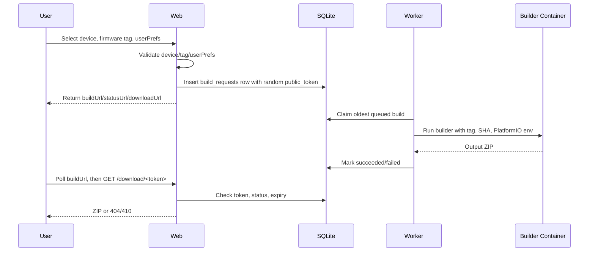

# Architecture

Meshtastic Builder is split into three runtime responsibilities:

1. Web/API process
2. Queue worker
3. Ephemeral firmware builder container

The web process accepts user input, validates it, stores a queued build request in SQLite, and serves status/download endpoints. It does not invoke Docker.

The worker process claims queued rows one at a time, writes build inputs to a temporary job directory, runs the builder container, stores the resulting ZIP, and updates the database. The user follows progress on the private build URL returned at submit time.

The builder container contains the Meshtastic firmware repository, Git, Python, PlatformIO CLI, and a shell entrypoint that fetches tags, checks out the requested firmware version, optionally applies the repo-controlled patches the worker staged in `input/patches/`, and runs `pio run -e <env>`.

Most customization is expressed through `userPrefs.jsonc`. Settings that upstream firmware never reads from a `USERPREFS_*` macro are exposed as advanced build options, which add those reads via that patch. See [Advanced Build Options](build-options.md).

## Flow

## Main Modules

- `meshtastic_builder.app`: HTTP server, API routes, static assets, downloads.
- `meshtastic_builder.submissions`: request validation and build creation.
- `meshtastic_builder.code_options`: advanced build option allowlist and macro expansion.
- `meshtastic_builder.db`: SQLite schema and queue transitions.
- `meshtastic_builder.firmware`: GitHub tag sync and `userPrefs.jsonc` template fetching.
- `meshtastic_builder.worker`: queue loop and build lifecycle.
- `meshtastic_builder.builder`: Docker/fake build execution and ZIP metadata.
- `meshtastic_builder.cleanup`: artifact expiry and deletion.

## Runtime Data

By default runtime state lives under `./var`:

- `var/meshtastic-builder.sqlite`
- `var/artifacts/*.zip`
- `var/jobs/<token>/`
- `var/cache/userprefs/*.jsonc`

The `var/` directory is intentionally ignored by Git.

